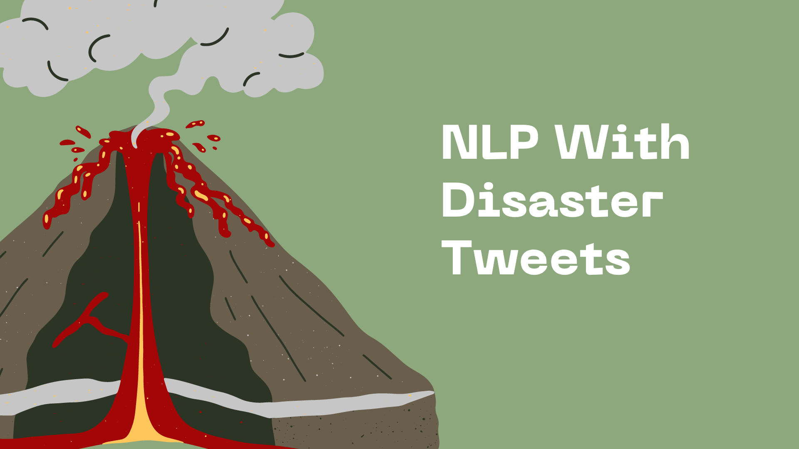
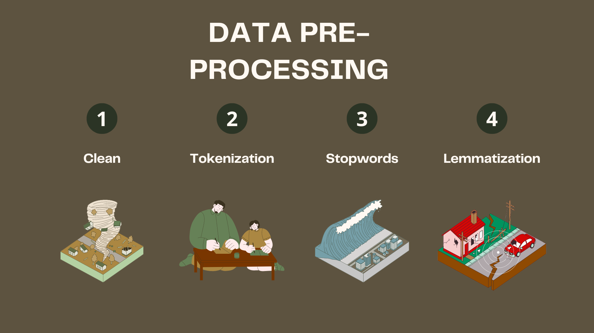
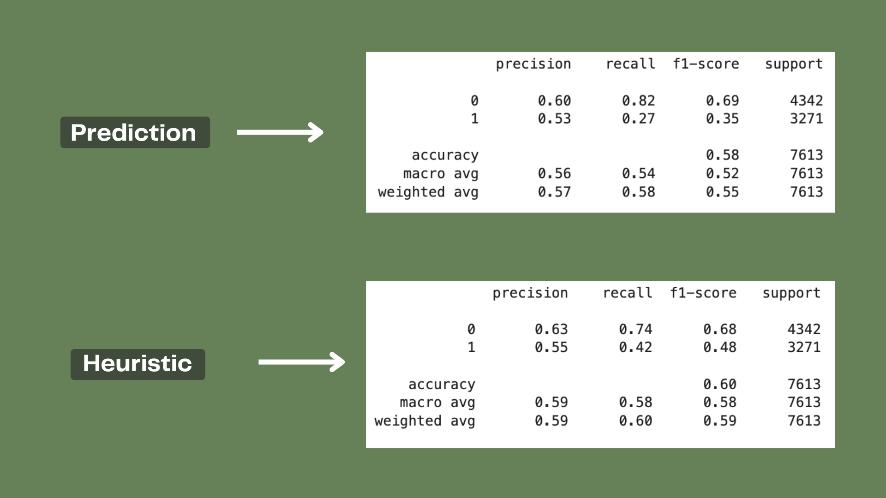
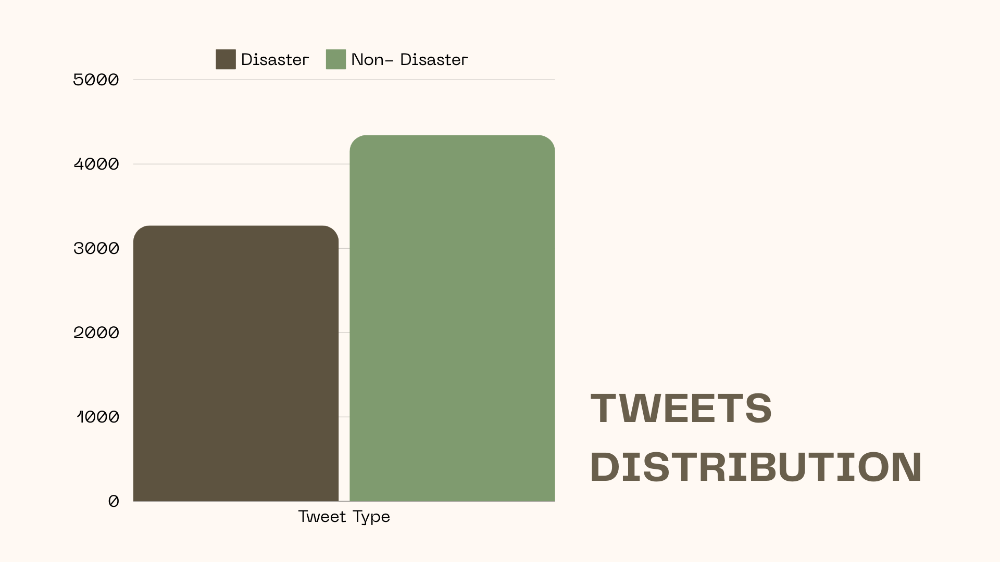
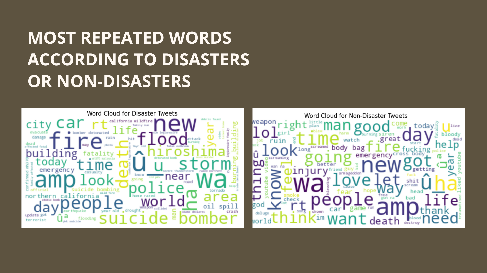
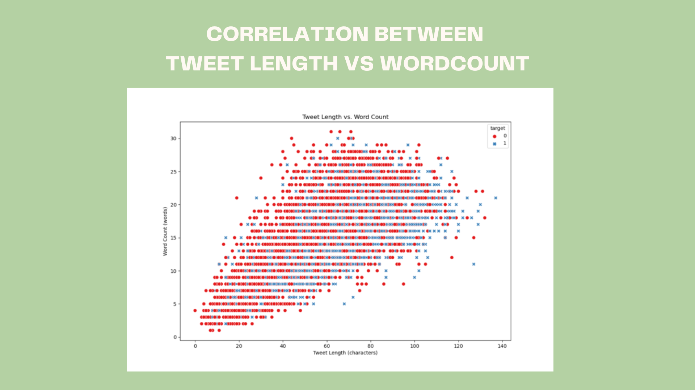
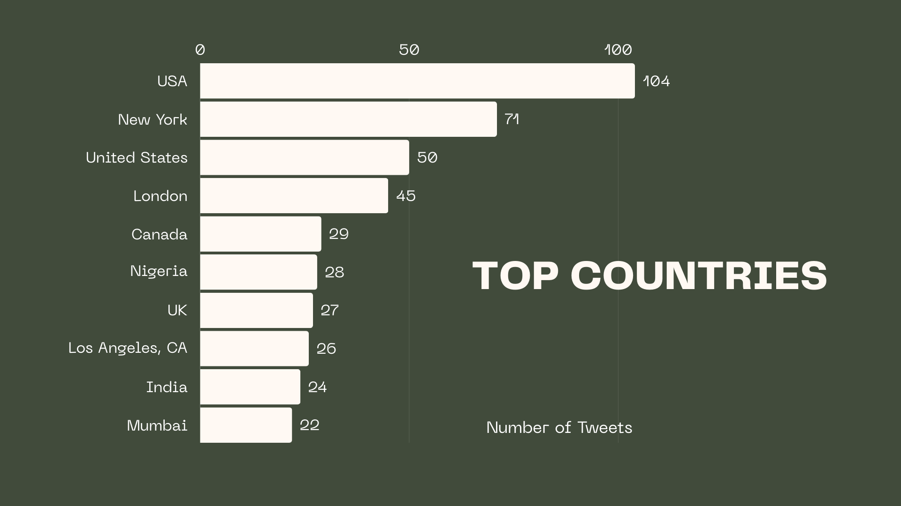

# NLP TwiSOS: NLP for Disaster-Related Tweets

### Natural Language Processing · Text Classification · Social Media Analysis

## Project Overview

Can text and sentiment analysis help identify tweets related to real-world disasters?

For this project, I worked with the **NLP Getting Started** dataset from Kaggle, containing **7,613 tweets** labelled according to whether they refer to a real disaster or not.

The project explores whether sentiment-related features can help distinguish disaster-related tweets from non-disaster tweets.

---

## Research Question

**Can text preprocessing and sentiment-based features help identify tweets related to real-world disasters?**

## Objectives

- Preprocess and transform unstructured Twitter text.
- Explore sentiment-related features in disaster and non-disaster tweets.
- Test sentiment-based rules for classifying disaster-related content.
- Evaluate the results using precision, recall and F1-score.
- Identify the limitations of using sentiment to classify disaster-related tweets.

---

## Dataset

The dataset contains **7,613 tweets** with the following variables:

- `id`: unique tweet identifier
- `keyword`: keyword associated with the tweet
- `location`: location associated with the tweet
- `text`: tweet content
- `target`: `1` = real disaster, `0` = not a real disaster

The analysis focused primarily on the `text` variable.

---

## Methodology

### 1. Text Preprocessing

The tweets were cleaned and transformed using:

- Lowercasing
- URL removal
- Special character and number removal
- Tokenization
- Stopword removal
- Lemmatization

### 2. Feature Engineering

I explored textual features including **spaCy vector representations** and sentiment scores generated with **VADER**.

For each tweet, VADER provided:

- Negative sentiment
- Neutral sentiment
- Positive sentiment
- Compound score

Importantly, **sentiment was not the target variable**. The target was whether the tweet referred to a real disaster.

### 3. Rule-Based Classification

Instead of training a supervised machine learning model, I tested two sentiment-based classification rules using different thresholds.

The first approach achieved:

- **Accuracy:** 58%
- **Recall — disaster class:** 27%
- **F1-score — disaster class:** 0.35

After adjusting the thresholds, the second approach achieved:

- **Accuracy:** 61%
- **Recall — disaster class:** 48%
- **F1-score — disaster class:** 0.51

---

## Exploratory Analysis

I also explored the dataset through:

- Disaster vs. non-disaster tweet distribution
- Word clouds
- Tweet-length distributions
- Word counts
- Location analysis
- Relationship between tweet length and word count

---

## Key Findings

The second heuristic improved the detection of disaster-related tweets, increasing recall from **27% to 48%** and F1-score from **0.35 to 0.51**.

However, the results showed that **sentiment alone is not sufficient to reliably identify disaster-related content**.

A tweet can describe a disaster using neutral language, while a non-disaster tweet can contain strongly negative language.

### Key Insight

> **Sentiment and topic are not the same thing.**

The project highlighted the importance of considering context when analysing unstructured text and of evaluating the limitations of an analytical approach rather than relying only on overall accuracy.

---

## Limitations & Future Improvements

The classification approach was **rule-based**, and the sentiment thresholds were heuristic.

A future version could compare this approach with supervised machine learning models such as:

- Logistic Regression
- Naive Bayes
- Support Vector Machines

TF-IDF or more advanced document-level embeddings could also be used to incorporate more contextual information.

---

## Tools

`Python` · `Pandas` · `NLTK` · `spaCy` · `Matplotlib` · `Seaborn` · `Scikit-learn`
